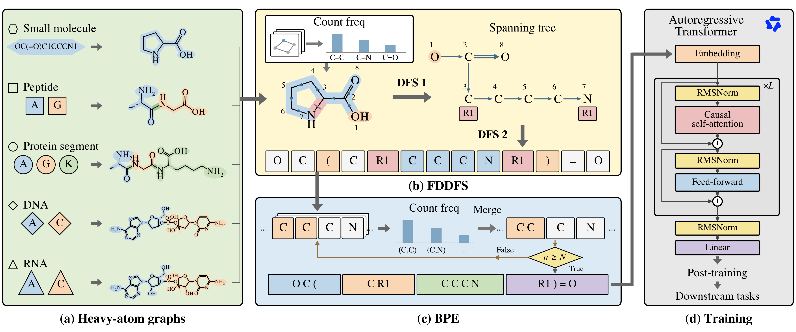

# MolToken

**Scaling a Molecular Foundation Model with Unified Tokenization across Chemical and Biological Space**

MolToken represents small molecules, peptides, proteins, DNA and RNA with a
shared vocabulary. Each input is expanded into a heavy-atom graph, serialized
with Frequency Dual Depth First Search (FDDFS), and compressed with byte-pair
encoding (BPE). The resulting tokens are used for autoregressive pretraining
and downstream fine-tuning.



This repository includes graph construction and inverse decoding, FDDFS and BPE,
single- and multi-domain pretraining, two-stage fine-tuning, generation, and
benchmark evaluation. The pretrained tokenizer is included; datasets, model
weights and external evaluator assets are supplied separately.

## Installation

Requires Linux, Python 3.10 or newer, and a C++17 compiler. Run the following
commands from the repository root:

```bash
python -m venv .venv
source .venv/bin/activate
python -m pip install --upgrade pip
python -m pip install -e '.[train,data]'
```

For tokenization only, use `python -m pip install -e .`. Both commands compile
the native FDDFS and BPE extensions. GPU pretraining with sample-isolated
attention also requires an xFormers build matching the installed PyTorch and
CUDA versions. Large-corpus `.zst` processing requires the `zstd` executable.

Evaluation dependencies are listed in [Benchmark evaluation](docs/benchmarks.md).

## Quick start

Encode any of the five molecular domains with the same tokenizer:

```python
from moltoken import MolTokenizer

tokenizer = MolTokenizer()
examples = {
    "small_molecule": "CCO",
    "peptide": "AGK",
    "protein": "ACDEFG",
    "dna": "ACGT",
    "rna": "ACGU",
}

for domain, sequence in examples.items():
    ids = tokenizer.encode(sequence, domain=domain)
    if domain == "small_molecule":
        decoded = tokenizer.decode_smiles(ids)
    else:
        decoded = tokenizer.decode_sequence(ids, domain)
    print(domain, ids, decoded)
```

`encode()` returns raw BPE IDs. Use `model_ids=True` to add the model's token
offset and BOS/EOS markers. `decode_graph()` reconstructs the heavy-atom graph.

## Pretrained models

Load a local checkpoint containing `config.json` and its model weights:

```python
import torch
from moltoken import load_pretrained

model = load_pretrained(
    "checkpoints/moltoken_0.55b", device="cuda", dtype=torch.bfloat16,
)
```

The same loader supports the 0.55B and 1.44B models and smaller scaling-study
checkpoints, in either PyTorch or safetensors format. Use the included MolToken
tokenizer with these models. Conditional checkpoints are loaded with `load_sft()`;
see [Checkpoint formats](docs/checkpoints.md).

## Training and evaluation

Prepare a corpus from domain-labelled JSONL records:

```bash
moltoken encode-corpus --input examples/toy_corpus.jsonl \
  --output data/encoded/shard_000.bin
python -m cli.data.build_compact_int_index \
  --input-shards data/encoded/shard_000.bin --index-dir data/index
```

[Pipeline](docs/pipeline.md) describes corpus preparation, pretraining,
held-out loss evaluation and fine-tuning. Configurable launch examples are
provided in [examples/pretrain.sh](examples/pretrain.sh) and
[examples/sft.sh](examples/sft.sh). Fine-tuning uses alignment followed by full
training, with early stopping on a training-derived validation split.

Generation and evaluation commands are available through the `moltoken` CLI:

```bash
moltoken --help
moltoken pretrain --help
moltoken sft --help
moltoken sample-sft --help
moltoken moses --help
moltoken guacamol --help
```

## Documentation

| Guide | Contents |
|---|---|
| [Pipeline](docs/pipeline.md) | Data formats, pretraining, scaling experiments and fine-tuning |
| [Tokenizer training](docs/tokenizer_training.md) | Frequency guide, FDDFS serialization and integer BPE |
| [Checkpoint formats](docs/checkpoints.md) | Token IDs, model loading and conditional encoders |
| [Benchmark evaluation](docs/benchmarks.md) | Reference data, dependencies, generation and scoring |
| [Development](docs/development.md) | Source layout and tests |

## License

The project code is released under the [MIT License](LICENSE).
Third-party components and resources retain their original licenses; see
[Third-party notices](THIRD_PARTY_NOTICES.md).

## Research and rebuttal

The [research source map](docs/research.md) covers the E2/E3 ordering,
representation/pretraining controls, cross-domain transfer experiments and
scaling-study drivers. It distinguishes production and ablation tokenizers,
external assets, historical wrappers, and validation limits. Use a fixed Git
commit as the code baseline for new experiments.
